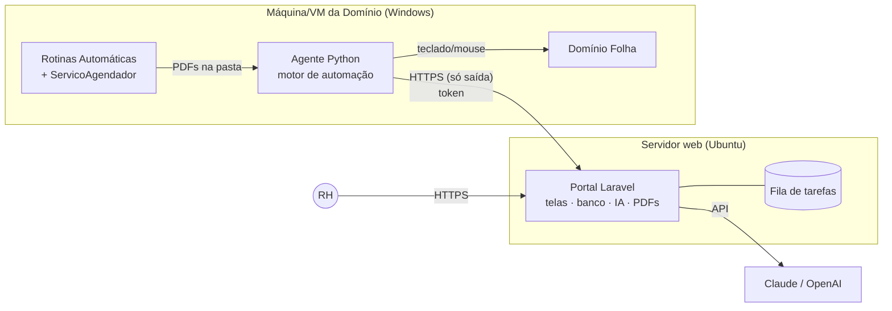

# Portal da Folha · Automação de DP integrada à Domínio Sistemas

Portal web para escritórios de contabilidade e departamentos pessoais que usam a **Domínio Folha (Thomson Reuters)**.
O RH faz tudo pelo navegador — admissões, lançamentos do mês, conferência da folha e do adiantamento — e um
**agente** instalado na máquina (ou VM) da Domínio executa o trabalho no sistema e devolve os resultados ao portal.

> Projeto real em uso, publicado para portfólio. **Nenhum dado de cliente está neste repositório** — os testes usam dados fictícios.

## O que ele faz

| Módulo | Resumo |
|---|---|
| **Admissão com IA** | O RH envia RG, CPF, CTPS, comprovantes (PDF/foto). Um modelo de IA (Claude ou OpenAI, à escolha) lê os documentos e preenche a ficha; CPF/PIS/datas são validados e campos duvidosos ficam destacados. Após a aprovação, o agente cadastra o funcionário na Domínio. |
| **Adiantamento automático** | Um clique (ou o agendamento mensal) dispara a *Rotina Automática* da Domínio: importa os consignados do Crédito do Trabalhador, calcula o adiantamento e gera Extrato + Relação de Líquidos em PDF, que chegam sozinhos ao portal. |
| **Folha e extrato** | Lê o PDF "Extrato Mensal" da Domínio: resumo por funcionário com todos os eventos, consignados destacados, totais (INSS, FGTS, IRRF) e conferência automática da soma. Gera a relação de líquidos para assinatura. |
| **Lançamentos do mês** | Tela única para o RH lançar horas extras, dias de falta, comissões e desconto de VR de cada funcionário ativo, com validação, totais e fechamento da competência. Cada coluna é ligada a uma rubrica da Domínio (base para a importação em TXT). |
| **Funcionários e funções** | Cadastro sempre atualizado com a Domínio a cada folha importada + dados do escritório (local, VT, VR, chave PIX). Funções (cargo, CBO, salário mais comum) se atualizam sozinhas. |

## Arquitetura



- **Portal (Laravel 13, PHP 8.4)** — telas, regras, banco, leitura dos PDFs, geração de PDFs, chamada à IA.
- **Agente (Python, Windows)** — fica na máquina/VM que tem a Domínio. Só faz conexões de **saída** para o portal
  (busca tarefas, devolve resultados, envia PDFs): nenhuma porta precisa ser aberta no escritório.
- **Domínio** — o trabalho pesado (consignados, cálculo, relatórios) roda pelas **Rotinas Automáticas** nativas,
  que funcionam em segundo plano. O robô de tela é usado só onde não há rotina (ex.: cadastro de empregado).

## Destaques técnicos

- **Leitura de PDF por coordenadas**: o texto do Extrato Mensal vem embaralhado no arquivo; o parser remonta as linhas pela
  posição de cada trecho e extrai funcionários, rubricas e totais — validado contra relatórios reais (somas conferem centavo a centavo).
- **Saída estruturada da IA** com *JSON Schema* (SDK oficial da Anthropic / OpenAI Responses), sem "adivinhação" de campos.
- **Motor de automação declarativo**: os passos na Domínio ficam em `agente/roteiro.json` (menus, botões por nome, campos
  com máscara, diálogos esperados), então ajustar para outra versão da Domínio não exige mudar código.
- **Fila de tarefas atômica** (lock por transação) — uma tarefa nunca é executada duas vezes.

## Segurança e LGPD

- Segredos (chaves de API, senha SMTP, token do agente) ficam no `.env` ou **criptografados no banco** com a `APP_KEY`; nunca voltam para a tela.
- Dados pessoais no banco (ficha da admissão, folhas, chave PIX) usam *casts* `encrypted` do Laravel.
- API do agente autenticada por token de 64 caracteres (comparação em tempo constante); API fechada se o token não estiver configurado.
- Login com limite de tentativas; sessão regenerada; CSRF em todos os formulários.
- Documentos da admissão podem ser apagados após o cadastro (botão "Apagar documentos (LGPD)").
- Detalhes em [SECURITY.md](SECURITY.md).

## Rodando localmente

```bash
cd portal
composer install
cp .env.example .env && php artisan key:generate
php artisan migrate
php artisan portal:usuario voce@exemplo.com      # cria o usuário (senha pedida no terminal)
php artisan portal:token-agente                  # gera o AGENTE_TOKEN -> cole no .env
php artisan serve
php artisan queue:work                           # em outro terminal: leitura dos documentos com IA
```

Testes: `php artisan test` (unitários + feature, com extrato fictício em `portal/tests/Fixtures`).

Produção em Ubuntu (Nginx + PHP-FPM + MySQL/PostgreSQL + Let's Encrypt + fila como serviço): [docs/deploy-ubuntu.md](docs/deploy-ubuntu.md).
Agente na máquina/VM da Domínio: [docs/agente.md](docs/agente.md).

## Roadmap

Veja [ROADMAP.md](ROADMAP.md).

## Licença

Código disponibilizado para fins de portfólio. Todos os direitos reservados — uso comercial mediante autorização do autor.
